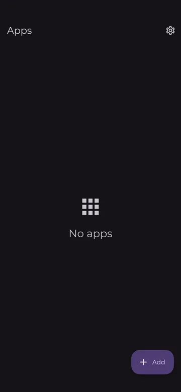
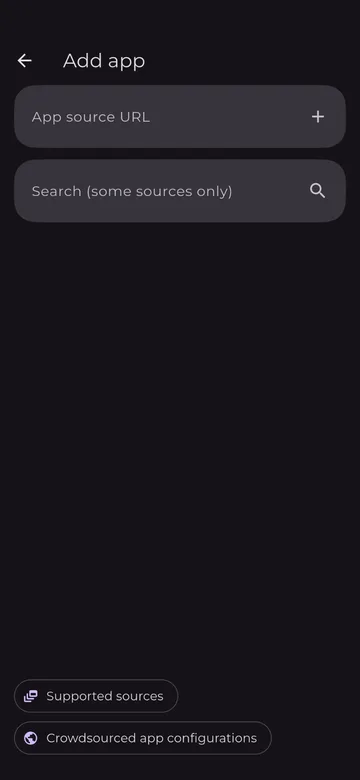
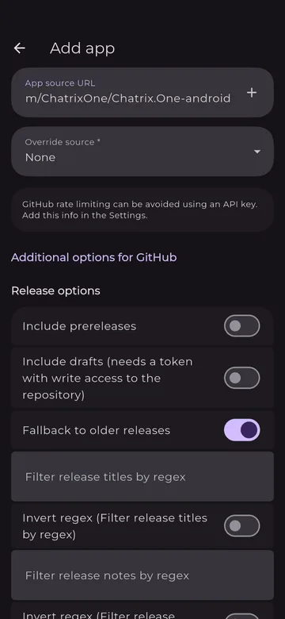
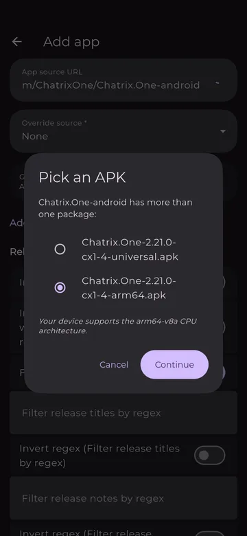
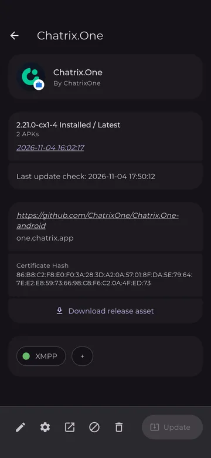
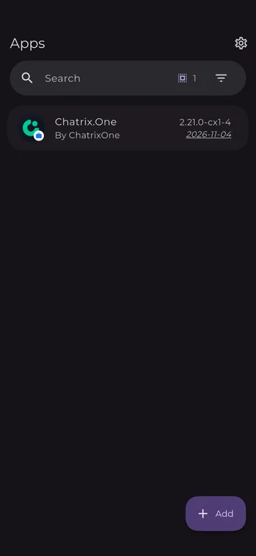

# Chatrix.One с Obtainium

**Chatrix.One** за Android се публикува като APK файлове в [GitHub releases](https://github.com/ChatrixOne/Chatrix.One-android/releases) на проекта (отворен код, лиценз GPL-3.0). Безплатното приложение **Obtainium** го инсталира директно оттам и известява при наличие на нова версия. Не са нужни профил и Google Play.

## 1. Инсталирайте Obtainium

Инсталирайте Obtainium от [F-Droid](https://f-droid.org/packages/dev.imranr.obtainium.fdroid/) или от неговите [GitHub releases](https://github.com/ImranR98/Obtainium/releases/latest).

!!! info "Информация"

    Първият път, когато инсталирате приложение извън Google Play, Android ще поиска разрешение за инсталиране от този източник. Точният текст зависи от телефона.

## 2. Добавете Chatrix.One

Отворете Obtainium. На екрана **Apps** натиснете **+ Add** долу вдясно.

{ .phone-shot loading=lazy }

Поставете този адрес в полето **App source URL**:

```
https://github.com/ChatrixOne/Chatrix.One-android
```

{ .phone-shot loading=lazy }

Под полето ще видите **Override source: None** и **Additional options for GitHub**. Там не е нужно да променяте нищо. Натиснете **+** вдясно от полето с адреса.

{ .phone-shot loading=lazy }

## 3. Изберете APK

Всяка версия има два APK файла, затова Obtainium показва **Pick an APK**. Изберете файла, завършващ на **arm64.apk** (обикновено Obtainium вече го е избрал), и натиснете **Continue**.

{ .phone-shot loading=lazy }

| Файл | Размер (2.21.0-cx1-4) | За |
|:-----|:---------------------:|:---|
| `…-arm64.apk` | ~31 MB | Телефони с 64-битов ARM процесор (`arm64-v8a`), т.е. почти всички съвременни телефони |
| `…-universal.apk` | ~64 MB | Всички останали устройства: `armeabi-v7a` (по-стари 32-битови телефони), `x86`, `x86_64` |

!!! tip "Съвет"

    Под списъка Obtainium показва архитектурата, която устройството ви поддържа, например *"Your device supports the arm64-v8a CPU architecture."*

## 4. Потвърдете инсталирането

Когато Android попита, потвърдете инсталирането (първият път ще поиска и разрешение за инсталиране от Obtainium). След това страницата на приложението показва инсталираната версия:

{ .phone-shot loading=lazy }

Проверете, че на страницата се вижда:

- име на пакета `one.chatrix.app`;
- **Certificate Hash** `86:B8:C2:F8:E0:F0:3A:28:3D:A2:0A:57:01:8F:DA:5E:79:64:7E:E2:E8:59:73:66:98:C8:F6:C2:0A:4F:ED:73`.

Всички версии на Chatrix.One са подписани с този ключ. **Chatrix.One** вече се вижда в списъка **Apps**.

{ .phone-shot loading=lazy }

!!! info "Информация"

    **Download release asset** на страницата на приложението изтегля отделен файл от версията (APK или архив с изходния код). Той не ви е нужен за инсталиране или обновяване.

## Обновяване

Obtainium проверява GitHub releases във фонов режим, по подразбиране на всеки 6 часа (може да се промени в настройките на Obtainium), и известява при наличие на нова версия. Страницата на приложението показва часа на последната проверка (**Last update check**). При наличие на нова версия отворете Chatrix.One в Obtainium и натиснете **Update**.

## Вече сте инсталирали APK ръчно?

Ако сте инсталирали Chatrix.One, като сте изтеглили APK файла от GitHub, добавете го в Obtainium по описания начин. Ръчно инсталираният APK и този от Obtainium са подписани с един и същ ключ, затова приложението се обновява на място: без преинсталиране, а профилите и съобщенията ви се запазват.

## Отстраняване на проблеми

Ограничение на GitHub (rate limit)
:   GitHub ограничава колко често може да се проверяват версиите без профил. Самият Obtainium съобщава: *"GitHub rate limiting can be avoided using an API key. Add this info in the Settings."* Обикновено това не е нужно.

"App not installed"
:   Android отказва обновяване, подписано с различен ключ. Проверете **Certificate Hash** по-горе. Ако е инсталиран Chatrix.One с различен ключ, той трябва първо да бъде деинсталиран (това изтрива локалните му данни).

* * *

Обратно към [Клиенти](../clients.md).
