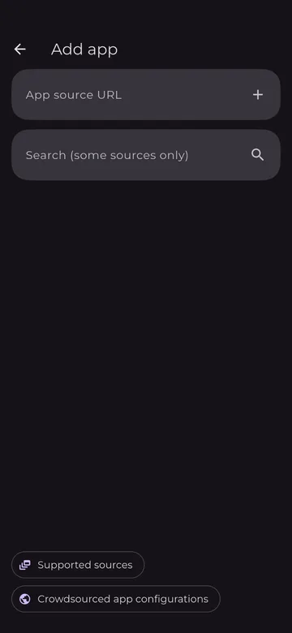
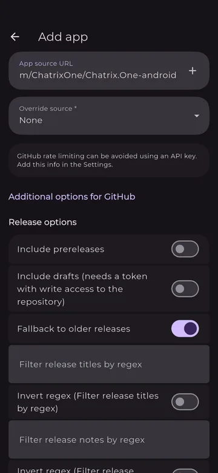
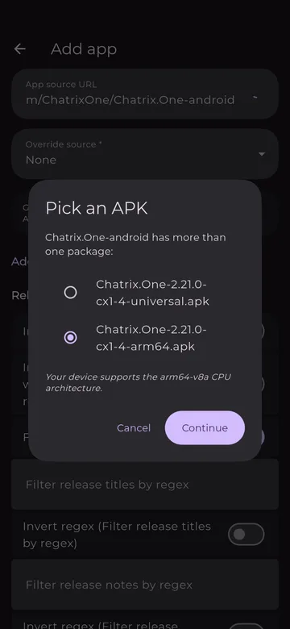
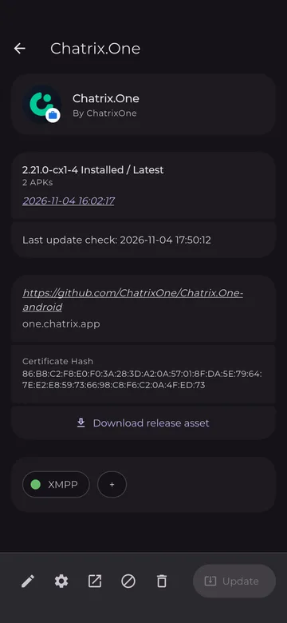
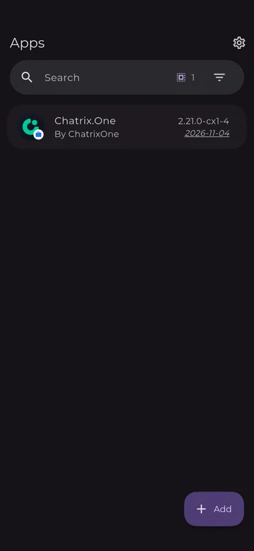

# Chatrix.One with Obtainium

**Chatrix.One** for Android is published as APK files in the [GitHub releases](https://github.com/ChatrixOne/Chatrix.One-android/releases) of the project (open source, GPL-3.0 license). The free app **Obtainium** installs it straight from there and tells you when a new version is out. No account and no Google Play are needed.

## 1. Install Obtainium

Install Obtainium from [F-Droid](https://f-droid.org/packages/dev.imranr.obtainium.fdroid/) or from its [GitHub releases](https://github.com/ImranR98/Obtainium/releases/latest).

!!! info "Information"

    The first time you install an app from outside Google Play, Android asks you to allow installs from that source. The exact wording depends on the phone.

## 2. Add Chatrix.One

Open Obtainium. On the **Apps** screen, press **+ Add** at the bottom right.

{ .phone-shot loading=lazy }

Paste this address into the **App source URL** field:

```
https://github.com/ChatrixOne/Chatrix.One-android
```

{ .phone-shot loading=lazy }

Below the field you will see **Override source: None** and **Additional options for GitHub**. Nothing needs to be changed there. Press the **+** on the right of the address field.

{ .phone-shot loading=lazy }

## 3. Pick an APK

Each release has two APK files, so Obtainium shows **Pick an APK**. Choose the file ending in **arm64.apk** (Obtainium usually selects it already) and press **Continue**.

{ .phone-shot loading=lazy }

| File | Size (2.21.0-cx1-4) | For |
|:-----|:-------------------:|:----|
| `…-arm64.apk` | ~31 MB | Phones with a 64-bit ARM processor (`arm64-v8a`), which is almost every phone today |
| `…-universal.apk` | ~64 MB | All other devices: `armeabi-v7a` (older 32-bit phones), `x86`, `x86_64` |

!!! tip "Tip"

    Under the list Obtainium shows which architecture your device supports, for example *"Your device supports the arm64-v8a CPU architecture."*

## 4. Confirm the install

When Android asks, confirm the install (the first time, it also asks you to allow installs from Obtainium). After that, the app page shows the installed version:

{ .phone-shot loading=lazy }

Check that the page shows:

- package name `one.chatrix.app`;
- **Certificate Hash** `86:B8:C2:F8:E0:F0:3A:28:3D:A2:0A:57:01:8F:DA:5E:79:64:7E:E2:E8:59:73:66:98:C8:F6:C2:0A:4F:ED:73`.

All Chatrix.One releases are signed with this key. **Chatrix.One** now appears in the **Apps** list.

{ .phone-shot loading=lazy }

!!! info "Information"

    **Download release asset** on the app page lets you download a single file of the release (APK or source archive). You don't need it for installing or updating.

## Updates

Obtainium checks the GitHub releases in the background, every 6 hours by default (**Settings → Updates → Background update checking interval**), and tells you when a new version is out. The app page shows the time of the **Last update check**. When a new version is available, open Chatrix.One in Obtainium and press **Update**.

## Already installed the APK by hand?

If you installed Chatrix.One by downloading the APK from GitHub, add it to Obtainium as described above. The APKs installed by hand and through Obtainium are signed with the same key, so the app updates in place: no reinstall, and your accounts and messages stay.

## Troubleshooting

GitHub rate limit
:   GitHub limits how often its releases can be checked without an account. Obtainium itself says: *"GitHub rate limiting can be avoided using an API key. Add this info in the Settings."* Usually you don't need this.

"App not installed"
:   Android refuses an update signed with a different key. Check the **Certificate Hash** above. If a Chatrix.One with a different key is installed, it has to be uninstalled first (this deletes its local data).

* * *

Back to [Clients](../clients.md).
